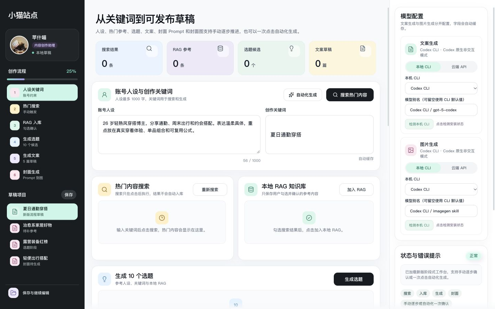

# 小猫站点

`小猫站点` 是一个 React + Vite 桌面端 Web App，用于辅助生成小红书内容草稿。页面以阶段式工作台表达完整流程：人设和关键词输入、热门内容搜索、加入本地 RAG、生成选题、生成文案、生成封面 Prompt、生成封面图。当前示例创作者名为「苹什喵」，页面头像统一使用 `public/assets/avatar-pingshimiao.png`。

项目保持 3 列内容创作工作台形态，采用黑白主框架、深炭色导航、浅色数据卡和细线图标的现代 SaaS 仪表盘视觉。当前链路支持本机 `xhs` CLI 热门搜索、本地 Codex/Kimi/Claude/自定义规范 CLI 文本生成、Codex 本地图片生成，以及云端 OpenAI-compatible API 生成；RAG 入库支持用户手动勾选确认，也支持用户点击“自动化生成”后由文案模型选择参考内容并入库。

## 预览



浏览器页面不包含设备外框或展示背景，可直接编辑人设、关键词与模型配置。

## 本地运行

最省心的启动方式：

- macOS：双击 `启动小猫站点.command`
- Windows：双击 `启动小猫站点.bat`

脚本会使用固定地址 `http://127.0.0.1:52880`，缺少 `node_modules` 时会先执行 `npm install`，然后等待本地服务启动并自动打开浏览器。模型配置写入浏览器 `localStorage`，固定地址可以避免端口变化导致缓存读不到。

命令行启动同一个固定地址：

```bash
npm run launch:fixed
```

开发时如果不想每次启动前构建，可以使用：

```bash
npm run launch:dev
```

本地构建后预览：

```bash
npm run deploy:local
```

临时启动开发服务器：

```bash
npm run dev
```

构建检查：

```bash
npm run build
```

本地 Codex CLI 默认通过系统 PATH 查找 `codex`，可通过环境变量覆盖：

```bash
CODEX_CLI_PATH=/path/to/codex npm run launch:fixed
```

Kimi CLI 默认通过系统 PATH 查找 `kimi`，可通过环境变量覆盖。首次使用前请在终端完成 `kimi login`；页面点击“检测本机 CLI”后会显示版本和可用状态：

```bash
KIMI_CLI_PATH=/path/to/kimi npm run launch:fixed
```

Claude Code 默认通过系统 PATH 查找 `claude`，可通过环境变量覆盖。首次使用前请在终端完成 `claude auth login`；适配器使用官方非交互 JSON 模式，并关闭工具调用和会话持久化：

```bash
CLAUDE_CLI_PATH=/path/to/claude npm run launch:fixed
```

右侧“文案生成”可以选择 Codex、Kimi、Claude，或填写符合 小猫站点 print protocol 的自定义命令。自定义 CLI 需要支持 `--version`、`--prompt`、可选 `--model` 和 `--output-format stream-json`，最终 stdout 需包含 `{"role":"assistant","content":"<valid JSON>"}`。本地图片生成当前只显示具备 native imagegen 能力的 Codex CLI。

小红书热门搜索通过本机 `xhs` CLI 触发，默认通过系统 PATH 查找 `xhs`，默认只使用 CLI 已保存登录态：

```bash
XHS_CLI_COMMAND=/path/to/xhs XHS_COOKIE_SOURCE=none npm run launch:fixed
```

如果搜索提示未登录，请先在终端手动运行 `xhs login`，再回到页面点击搜索。前端不会读取、展示或保存 Cookie。

云端 API 路线在右侧模型配置中填写：模型名称、API Key、API Base URL。文案生成走 `POST /chat/completions`，图片生成走 `POST /images/generations`，服务端会把图片结果统一校验并发布为 `/generated/covers/*.png`。

请在本机运行时填写自己的 API Key，不要把真实密钥写入源码、测试、文档或提交到 GitHub。模型配置（包括 API Key）会保存在当前浏览器的 localStorage 中；共用电脑时，请在使用后清除该站点的浏览器存储。

## 草稿与参考内容

- 人设和创作关键词可直接编辑；关键词使用多行输入框。热门搜索结果只有在勾选并点击“加入 RAG”后才会入库。已入库的参考内容可逐条删除，删除时对应的搜索勾选会取消。
- 左侧“保存与继续编辑”会保存当前草稿项目，并定位到可继续编辑的关键词、撰写思路或所选文案标题。已保存项目可以重新打开、新建或删除；新建和删除会先确认。
- 所选文案的标题、正文可修改，小红书预览会同步更新。修改文案后，依赖旧文案的封面 Prompt 和封面图会清除，需要重新生成；“保存修改”会更新当前本地草稿项目。
- 未生成封面时，小红书预览显示项目自制的无水印黑色猫爪占位图；只有实际生成的 PNG 可用于发送。

## 发送到微信文件传输助手（macOS）

1. 在 Mac 微信中登录并打开自己的“文件传输助手”会话。
2. 在站点中选择文案并生成真实封面 PNG，点击小红书预览区的“发送到微信文件传输助手”。核对弹窗里的封面、标题和正文。
3. 直发需要给**启动站点的程序**授权 macOS“隐私与安全性 → 辅助功能”。使用 `启动小猫站点.command` 时，通常应授权“终端”，而不是把 `.command` 文件加入权限列表。若页面提示“授权辅助功能”，可点击按钮并在系统设置中开启对应程序的开关，再回页面点击“重新检查”。
4. 当前微信版本若不提供可读取的聊天控件，还需在“隐私与安全性 → 录屏与系统录音”给启动站点的程序授权；按系统提示重新启动站点，然后在弹窗中点击“重新检查”。这是本机核对微信会话标题和发送按钮所需的权限。
5. 状态显示可以发送后，再点击“确认发送到文件传输助手”。程序会核对目标，先发送封面图，再发送标题与正文；完成后请到微信确认这两条消息。若提示部分发送，先检查微信中的实际结果，不要直接重复点击。

未获得权限、无法核对目标或封面文件失效时，直发会停止。弹窗仍提供“复制标题与正文”“下载封面图”和[官方网页版文件传输助手](https://filehelper.weixin.qq.com/)入口，可手动发送。发送目标仅限自己的文件传输助手；当前不支持飞书、微信联系人或群聊。**直发代码已实现，但尚未在当前 Mac 完成真实发送验证**：微信 4.1 未暴露所需聊天控件，目前状态检查返回 `SCREEN_RECORDING_REQUIRED`，等待录屏权限与用户实际流程验证。详见 `docs/VERIFICATION.md` 和 `docs/QA_LOG.md`。

## 文档入口

- `docs/SPEC.md`：详细产品规格和完整核心流程。
- `AGENTS.md`：项目契约、边界、实现地图和修改规则。
- `docs/DESIGN.md`：视觉系统、布局规则和资产风格。
- `docs/VERIFICATION.md`：构建、截图和交互验证清单。
- `docs/QA_LOG.md`：最近视觉 QA 记录和当前状态。

## 当前项目状态

- 左侧：品牌、创作者资料、创作流程、可保存/打开/删除的草稿项目和“保存与继续编辑”入口。
- 中间：概览、人设关键词、热门搜索、可逐条删除的 RAG 参考、选题候选、撰写思路、可编辑文案、小红书预览、封面 Prompt 和 PNG 封面图结果；真实封面生成后可打开微信发送前预览。
- 右侧：文案模型配置、本机 CLI 选择与主动检测、图片模型配置、生成通道状态、错误提示、错误覆盖检查。
- 本地 React state 驱动流程推进、结果选择、错误提示和封面图展示；人设、关键词、撰写思路、模型配置和已保存草稿项目使用浏览器本地存储。

核心边界：搜索、RAG 入库、文本生成和封面图生成都必须由用户主动点击触发；“自动化生成”只代表本次点击授权串行完成搜索、模型决策入库、生成与封面图生成，不做后台轮询。当前不做自动发布、自动点赞、自动评论、自动收藏、自动关注、自动私信或自动批量采集。
